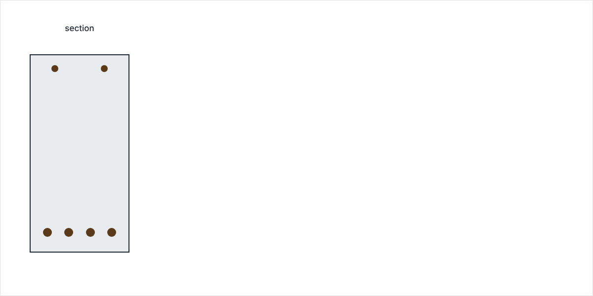
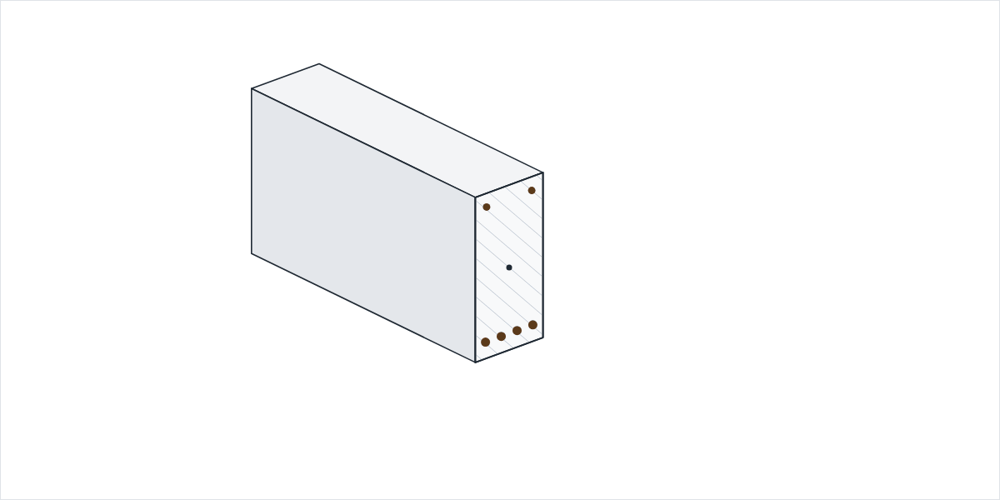

# Cross-section Analysis

`CrossSectionAnalysis` computes the serviceability (SLS) stresses and strains of any `ReinforcedCrossSection` —
rectangular, circular or custom — directly from its section forces.



This guide has three pages:

- **This page** — a quick start and the axes, signs and units of the section forces.
- **[SLS Stress/Strain Analysis](sls.md)** — the cracked/uncracked decision, creep, sagging and hogging, biaxial bending
  and other section shapes.
- **[Validation](validation.md)** — hand calculations and a comparison with IDEA StatiCa RCS.

## Quick start

Build the section once, create the analyzer, and pass it a set of `SectionForces`. The example is a 300 × 600 mm C30/37
beam with 4⌀25 B500B bars on the lower edge; the same beam is used throughout this guide.

```python exec="on" source="material-block" result="ansi" session="rc_index"
from blueprints.materials.concrete import ConcreteMaterial, ConcreteStrengthClass
from blueprints.materials.reinforcement_steel import ReinforcementSteelMaterial, ReinforcementSteelQuality
from blueprints.structural_sections.concrete.reinforced_concrete_sections.analysis import CrossSectionAnalysis
from blueprints.structural_sections.concrete.reinforced_concrete_sections.rectangular import RectangularReinforcedCrossSection
from blueprints.structural_sections.section_forces import SectionForces

concrete = ConcreteMaterial(concrete_class=ConcreteStrengthClass.C30_37)
steel = ReinforcementSteelMaterial(steel_quality=ReinforcementSteelQuality.B500B)
cs = RectangularReinforcedCrossSection(width=300, height=600, concrete_material=concrete)
cs.add_longitudinal_reinforcement_by_quantity(n=4, diameter=25, edge="lower", cover=50, material=steel)

analysis = CrossSectionAnalysis(cs)
result = analysis.stress(SectionForces(n=-100, m_y=150))  # 100 kN compression, 150 kNm sagging

print(f"Regime:                    {result.regime.value}")
print(f"Max concrete compression:  {result.concrete_stress_min:.2f} MPa")
print(f"Max reinforcement stress:  {max(bar.stress for bar in result.rebar_results):.1f} MPa")
print(f"Neutral-axis depth:        {result.strain_plane.neutral_axis_depth:.1f} mm")
```

Blueprints decided that the section cracks under these forces and returned the cracked stress state. `result.plot()`
draws it over the section height:

```python exec="on" source="above" result="html" html="true" session="rc_index"
result.plot()

from io import StringIO  # markdown-exec: hide
import matplotlib.pyplot as plt  # markdown-exec: hide

buffer = StringIO()  # markdown-exec: hide
plt.savefig(buffer, format="svg")  # markdown-exec: hide
print(buffer.getvalue())  # markdown-exec: hide
```

!!! note "Note"

    Use `plt.show()` in a script to open the figure in a window.

## Axes, signs and units

**Tension is positive, compression is negative**, for the axial force, the strains and the stresses alike. Forces are in
kN and kNm, lengths in mm, stresses in MPa and strains in ‰ (per mille).



The forces follow the member axes of
the [SAF](https://www.saf.guide/en/stable/getting-started/introduction.html#coordinate-systems) format: `x` along the
member, `y` horizontal and `z` vertical in the cross-section. The axial force acts at the centroid of the concrete
outline (mid-height for a rectangle), and the moments are taken about that point.

| Quantity           | Code                | Unit | Positive means                     |
|--------------------|---------------------|------|------------------------------------|
| Axial force N      | `SectionForces.n`   | kN   | tension                            |
| Bending moment M_y | `SectionForces.m_y` | kNm  | sagging: tension at the lower face |
| Bending moment M_z | `SectionForces.m_z` | kNm  | tension at the left face           |

`SectionForces` also accepts the shear forces `v_y`, `v_z` and the torsional moment `m_x`, so a complete SAF result can be
passed in one go — for example with `SectionForces.from_saf_result(...)`.

## Scope

- **Shear and torsion** are not part of a strain-plane analysis; `v_y`, `v_z` and `m_x` are ignored.
- **Backend.** The section is meshed and analysed by
  [`concreteproperties`](https://robbievanleeuwen.github.io/concrete-properties/), a core Blueprints dependency. Every
  input and result is converted to the Blueprints conventions above.

The assumptions of the stress analysis itself — linear-elastic materials, the cracking criterion and creep — are listed
on the [SLS page](sls.md#assumptions).
