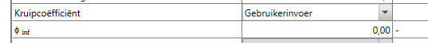
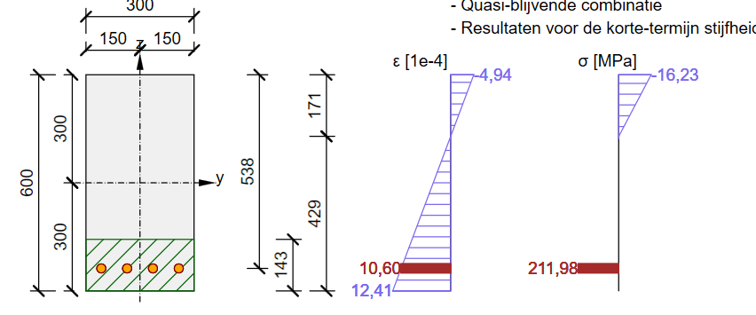
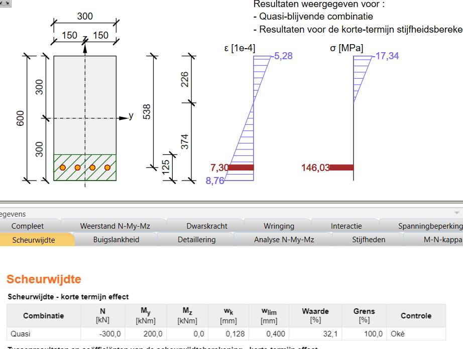
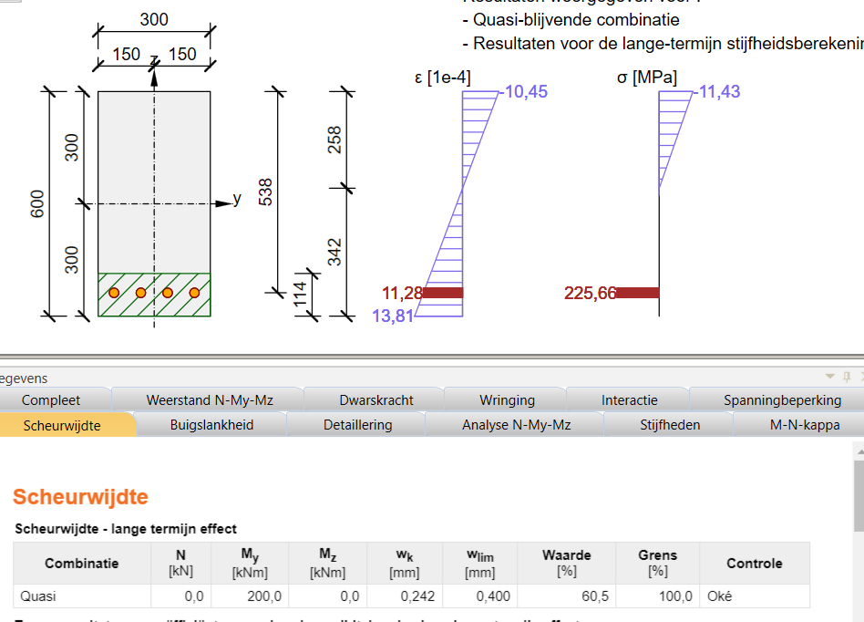
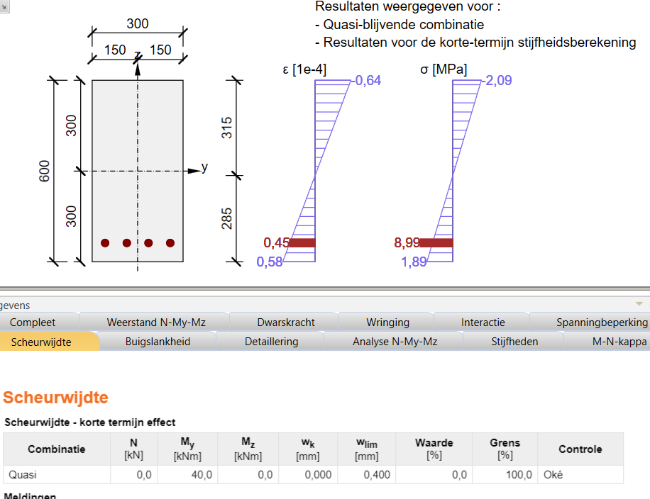

# Validation of the Cross-section Analysis

The `CrossSectionAnalysis` results are validated in two independent ways: **hand calculations** that can be followed on paper, and a comparison with **IDEA StatiCa RCS** on precisely defined reference cases. Both are pinned in the automated test suite.

!!! note "Reference section and material values"

    All cases use the **reference beam** of this guide: rectangular 300 × 600 mm, C30/37, 4⌀25 B500B on the lower edge with 50 mm cover (effective depth `d = 600 − 50 − 25/2 = 537.5 mm`, `A_s = 1963 mm²`).

    Material values: `E_cm = 32 836 MPa`, `E_s = 200 000 MPa` → modular ratio `α_e = E_s / E_cm = 6.09`.

The Blueprints side of every hand calculation runs on this analyzer:

```python exec="on" source="material-block" session="rc_validation"
from blueprints.materials.concrete import ConcreteMaterial, ConcreteStrengthClass
from blueprints.materials.reinforcement_steel import ReinforcementSteelMaterial, ReinforcementSteelQuality
from blueprints.structural_sections.concrete.reinforced_concrete_sections.analysis import CrossSectionAnalysis
from blueprints.structural_sections.concrete.reinforced_concrete_sections.rectangular import RectangularReinforcedCrossSection
from blueprints.structural_sections.section_forces import SectionForces

cs = RectangularReinforcedCrossSection(width=300, height=600, concrete_material=ConcreteMaterial(ConcreteStrengthClass.C30_37))
cs.add_longitudinal_reinforcement_by_quantity(
    n=4, diameter=25, edge="lower", cover=50, material=ReinforcementSteelMaterial(ReinforcementSteelQuality.B500B)
)
analysis = CrossSectionAnalysis(cs)


def compare(quantity, hand, blueprints):
    print(f"{quantity:<8} hand {hand:8.2f}   Blueprints {blueprints:8.2f}   difference {100 * (blueprints / hand - 1):+.2f} %")
```

## Hand calculation — pure bending (cracked)

The reference beam under a pure bending moment $M = 200$ kNm ($N = 0$). Linear-elastic cracked transformed section: the concrete carries compression only, the steel is transformed with the modular ratio.

$$ A_s = 4 \cdot \frac{\pi}{4}\,(25)^2 = 1963\ \text{mm}^2, \qquad \alpha_e = \frac{E_s}{E_{cm}} = \frac{200\,000}{32\,836} = 6.09 $$

**1. Neutral axis** $x$ — the first moment of the cracked transformed area about the neutral axis (depth $x$ from the compression fibre) is zero, $\tfrac{b\,x^2}{2} = \alpha_e A_s\,(d - x)$:

$$ \frac{300}{2}\,x^2 = 6.09 \times 1963 \times (537.5 - x) \quad\Rightarrow\quad 150\,x^2 + 11\,955\,x - 6.426\times10^{6} = 0 $$

$$ x = \frac{-11\,955 + \sqrt{11\,955^2 + 4 \times 150 \times 6.426\times10^{6}}}{2 \times 150} = \frac{-11\,955 + 63\,234}{300} = 171.0\ \text{mm} $$

**2. Cracked second moment of area** about the neutral axis:

$$ I_{cr} = \frac{b\,x^3}{3} + \alpha_e A_s\,(d - x)^2 = \frac{300 \times 171.0^3}{3} + 6.09 \times 1963 \times (537.5 - 171.0)^2 = 2.106\times10^{9}\ \text{mm}^4 $$

**3. Stresses** from $\sigma = M\,y / I_{cr}$, the steel scaled by $\alpha_e$:

$$ \sigma_c = -\frac{M\,x}{I_{cr}} = -\frac{200\times10^{6} \times 171.0}{2.106\times10^{9}} = -16.24\ \text{MPa} $$

$$ \sigma_s = \frac{\alpha_e\,M\,(d - x)}{I_{cr}} = \frac{6.09 \times 200\times10^{6} \times 366.5}{2.106\times10^{9}} = 212.0\ \text{MPa} $$

```python exec="on" source="material-block" result="ansi" session="rc_validation"
result = analysis.stress(SectionForces(m_y=200))  # pure bending, N = 0
compare("x", 171.0, result.strain_plane.neutral_axis_depth)
compare("sigma_c", -16.24, result.concrete_stress_min)
compare("sigma_s", 212.0, max(bar.stress for bar in result.rebar_results))
```

## Hand calculation — combined N + M (cracked)

The same beam with an axial compression $N = -300$ kN alongside $M = 200$ kNm. $N$ acts at the centroid of the concrete outline, at mid-height. The neutral axis is no longer the pure-bending value: it follows from axial **and** moment equilibrium together.

With $P = 300$ kN the compressive force, the concrete forms a triangular compression block $C = \tfrac{1}{2}\,b\,x\,\sigma_c$ and the steel carries $T = \alpha_e A_s\,\sigma_c\,(d - x)/x$ (with $\sigma_c$ the magnitude of the top-fibre stress).

**1. Eccentricity** of $P$ measured from the reinforcement:

$$ e_s = \frac{M}{P} + \left(d - \frac{h}{2}\right) = \frac{200}{300}\times10^{3} + (537.5 - 300) = 904.2\ \text{mm} $$

**2. Neutral axis.** Axial equilibrium $C - T = P$ and moment equilibrium about the reinforcement $C\,(d - x/3) = P\,e_s$ combine into a cubic equation in $x$:

$$ x^3 - 3\,(d - e_s)\,x^2 + \frac{6\,e_s\,\alpha_e A_s}{b}\,x - \frac{6\,e_s\,\alpha_e A_s\,d}{b} = 0 $$

$$ x^3 + 1100\,x^2 + 2.163\times10^{5}\,x - 1.162\times10^{8} = 0 \quad\Rightarrow\quad x = 225.6\ \text{mm} $$

The neutral axis is 55 mm deeper than under pure bending (171.0 mm).

**3. Stresses.** From moment equilibrium about the reinforcement:

$$ C = \frac{P\,e_s}{d - x/3} = \frac{300\times10^{3} \times 904.2}{537.5 - 75.2} = 586.7\ \text{kN}, \qquad \sigma_c = -\frac{2\,C}{b\,x} = -\frac{2 \times 586.7\times10^{3}}{300 \times 225.6} = -17.34\ \text{MPa} $$

$$ \sigma_s = \alpha_e\,|\sigma_c|\,\frac{d - x}{x} = 6.09 \times 17.34 \times \frac{311.9}{225.6} = 146.0\ \text{MPa} $$

Check: $T = A_s\,\sigma_s = 1963 \times 146.0 = 286.7$ kN and $C - T = 586.7 - 286.7 = 300$ kN $= P$.

```python exec="on" source="material-block" result="ansi" session="rc_validation"
result = analysis.stress(SectionForces(n=-300, m_y=200))  # combined N + M
compare("x", 225.6, result.strain_plane.neutral_axis_depth)
compare("sigma_c", -17.34, result.concrete_stress_min)
compare("sigma_s", 146.0, max(bar.stress for bar in result.rebar_results))
```

!!! warning "Why this case matters"

    Reusing the pure-bending neutral axis ($x = 171$ mm) here, instead of solving for the actual $x = 226$ mm, would remove a 55 mm strip of concrete that is really in compression and overestimate the steel stress by about 25 %, an error that grows with the axial force. Blueprints therefore solves the true cracked N + M equilibrium; see [the two neutral-axis depths](sls.md#4-neutral-axis-and-cracked-section-properties).

## Hand calculation — uncracked

Under $M = 40$ kNm the section stays uncracked and the whole concrete section works together with the reinforcement. The transformed section adds the reinforcement as $(\alpha_e - 1)\,A_s$: the bars are counted with $\alpha_e$, minus the concrete they displace.

$$ A_{tr} = b\,h + (\alpha_e - 1)\,A_s = 180\,000 + 5.09 \times 1963 = 189\,996\ \text{mm}^2 $$

$$ \bar{y} = \frac{b\,h \cdot h/2 + (\alpha_e - 1)\,A_s \cdot d}{A_{tr}} = 312.5\ \text{mm (from the top)} $$

$$ I_{tr} = \frac{b\,h^3}{12} + b\,h\,(\bar{y} - h/2)^2 + (\alpha_e - 1)\,A_s\,(d - \bar{y})^2 = 5.934\times10^{9}\ \text{mm}^4 $$

$$ \sigma_{c,top} = -\frac{M\,\bar{y}}{I_{tr}} = -2.11\ \text{MPa}, \qquad \sigma_{c,bottom} = \frac{M\,(h - \bar{y})}{I_{tr}} = 1.94\ \text{MPa}, \qquad \sigma_s = \frac{\alpha_e\,M\,(d - \bar{y})}{I_{tr}} = 9.24\ \text{MPa} $$

```python exec="on" source="material-block" result="ansi" session="rc_validation"
result = analysis.stress(SectionForces(m_y=40))
compare("x", 312.5, result.strain_plane.neutral_axis_depth)
compare("sigma_c", -2.106, result.concrete_stress_min)
compare("sigma_ct", 1.938, result.concrete_stress_max)
compare("sigma_s", 9.24, max(bar.stress for bar in result.rebar_results))
```

!!! info "Further anchors in the test suite"

    The automated tests pin an additional closed-form result on this section: the **creep** case ($\varphi = 1$) against the transformed-section formulas with a doubled modular ratio.

## IDEA StatiCa RCS reference cases

The analyzer is also compared with IDEA StatiCa RCS on four cases with the reference beam. The IDEA results are read from its **crack-width (Scheurwijdte)** check: `x` is the neutral-axis depth, `σ_s` the reinforcement stress, and the strain/stress diagram gives the concrete stress and the strain plane.

!!! info "Reproducing these cases in IDEA StatiCa RCS"

    | Input | Value |
    |---|---|
    | Code / National Annex | EN 1992-1-1 / EN |
    | Section | rectangular 300 × 600 mm |
    | Concrete | C30/37 |
    | Reinforcement | 4⌀25 B500B, lower edge |
    | Concrete cover (to bar surface) | 50 mm (effective depth d = 537.5 mm) |
    | Case A — pure bending | `M_y = 200 kNm`, `N = 0`, short-term (φ = 0) |
    | Case B — combined N + M | `M_y = 200 kNm`, `N = -300 kN`, short-term (φ = 0) |
    | Case C — long-term (creep) | `M_y = 200 kNm`, `N = 0`, long-term with `φ = 2` |
    | Case D — uncracked | `M_y = 40 kNm`, `N = 0`, short-term (φ = 0) |
    | Load combination | quasi-permanent, `M_z = 0` |

    For the short-term cases the creep coefficient is set to zero, to compare with the Blueprints secant modulus `E_cm`; case C uses IDEA's long-term stiffness with `φ = 2`:

    

```python exec="on" source="material-block" result="ansi" session="rc_validation"
def report(label, forces, **kwargs):
    result = analysis.stress(forces, **kwargs)
    bar = max(result.rebar_results, key=lambda rebar: rebar.stress)
    print(label)
    print(f"  regime:                    {result.regime.value}")
    print(f"  max concrete compression:  {result.concrete_stress_min:.2f} MPa")
    print(f"  reinforcement stress:      {bar.stress:.2f} MPa   (strain {bar.strain:.3f} per mille)")
    print(f"  neutral-axis depth:        {result.strain_plane.neutral_axis_depth:.1f} mm")


report("Case A - pure bending (M_y = 200, N = 0)", SectionForces(m_y=200))
report("Case B - combined N + M (M_y = 200, N = -300)", SectionForces(n=-300, m_y=200))
report("Case C - long-term / creep (M_y = 200, N = 0, phi = 2)", SectionForces(m_y=200), creep_coefficient=2.0)
report("Case D - uncracked (M_y = 40, N = 0)", SectionForces(m_y=40))
```

### Case A — pure bending

| Quantity | Blueprints | IDEA StatiCa RCS | Difference |
|---|---|---|---|
| Regime | cracked | cracked | — |
| Max concrete compression [MPa] | −16.24 | −16.23 | 0.1% |
| Reinforcement stress [MPa] | 212.3 | 211.98 | 0.2% |
| Reinforcement strain [‰] | 1.061 | 1.060 | 0.1% |
| Neutral-axis depth [mm] | 170.8 | 171 | 0.1% |



The strain diagram (in units of 1e-4) reads −4.94 at the top fibre (−0.494‰) and 10.60 at the reinforcement (1.060‰); the stress diagram reads −16.23 MPa in the concrete and 211.98 MPa in the reinforcement; x = 171 mm.

### Case B — combined N + M

Adding a 300 kN axial compression checks the cracked **N + M** route of the hand calculation above, where the neutral axis deepens from 171 mm to 226 mm.

| Quantity | Blueprints | IDEA StatiCa RCS | Difference |
|---|---|---|---|
| Regime | cracked | cracked | — |
| Max concrete compression [MPa] | −17.35 | −17.34 | 0.1% |
| Reinforcement stress [MPa] | 146.2 | 146.03 | 0.1% |
| Reinforcement strain [‰] | 0.731 | 0.730 | 0.1% |
| Neutral-axis depth [mm] | 225.5 | 226 | 0.2% |



### Case C — long-term (creep)

Creep softens the concrete to the effective modulus `E_c,eff = E_cm / (1 + φ)`; at `φ = 2` the neutral axis deepens and the reinforcement stress rises.

| Quantity | Blueprints | IDEA StatiCa RCS | Difference |
|---|---|---|---|
| Regime | cracked | cracked | — |
| Max concrete compression [MPa] | −11.43 | −11.43 | 0.0% |
| Reinforcement stress [MPa] | 225.9 | 225.66 | 0.1% |
| Reinforcement strain [‰] | 1.130 | 1.128 | 0.2% |
| Neutral-axis depth [mm] | 258.2 | 258 | 0.1% |



### Case D — uncracked

A small moment keeps the section uncracked: the concrete carries tension below `f_ctm,fl` and no crack forms.

| Quantity | Blueprints | IDEA StatiCa RCS | Difference |
|---|---|---|---|
| Regime | uncracked | uncracked | — |
| Max concrete compression [MPa] | −2.11 | −2.09 | 1% |
| Max concrete tension [MPa] | +1.94 | +1.89 | 3% |
| Reinforcement stress [MPa] | 9.2 | 9.0 | 2% |
| Reinforcement strain [‰] | 0.046 | 0.045 | 2% |
| Neutral-axis depth [mm] | 312.5 | 315 | 0.8% |



The differences of 1–3 % come from one modelling choice in the uncracked transformed section. Blueprints counts the concrete displaced by the bars, adding the reinforcement as $(\alpha_e - 1)\,A_s$ as in the [hand calculation](#hand-calculation-uncracked). IDEA StatiCa RCS keeps the full concrete section and adds $\alpha_e\,A_s$ on top. Repeating the hand calculation with $\alpha_e\,A_s$ reproduces the IDEA values exactly:

| Transformed section | $\bar{y}$ [mm] | $I$ [mm⁴] | $\sigma_{c,top}$ [MPa] | $\sigma_{c,bottom}$ [MPa] | $\sigma_s$ [MPa] |
|---|---|---|---|---|---|
| $b\,h + (\alpha_e - 1)\,A_s$ — Blueprints | 312.5 | 5.934·10⁹ | −2.11 | +1.94 | 9.24 |
| $b\,h + \alpha_e\,A_s$ — IDEA StatiCa RCS | 314.8 | 6.033·10⁹ | −2.09 | +1.89 | 8.99 |

In the cracked cases A, B and C there are no bars in the compression zone, so the choice plays no role there and both programs agree within 0.2 %.

The cracking moment `m_cr` and the cracked second moment of area `i_cracked` are not compared: IDEA StatiCa RCS does not report them in its crack-width check.

!!! warning "Modelling differences"

    Blueprints performs a **linear-elastic SLS** analysis: concrete is linear up to cracking with the secant modulus `E_cm`, reinforcement is elastic up to `f_yk` (no partial factor), tension stiffening is **not** included, and the cracking decision uses the flexural tensile strength `f_ctm,fl` (EN 1992-1-1 formula 3.23). IDEA StatiCa RCS can use other choices (an effective or long-term modulus, tension stiffening per EN 1992-1-1 art. 7.4.3). When comparing, set up the IDEA case as a short-term linear analysis without tension stiffening. The tolerances in the automated test suite are set per reference case accordingly.

## Software versions

The IDEA StatiCa RCS comparison was performed with **IDEA StatiCa RCS 24.1.1.1479** and the **`concreteproperties` 0.8.0** backend, in July 2026.
